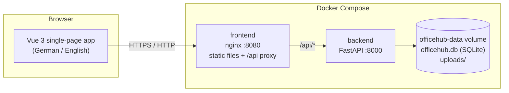

# OfficeHub

A clean, company-ready employee self-service portal for requests, documents, announcements, and simple office workflows.

OfficeHub is a small, self-hosted web app for small and medium-sized companies. Employees submit
vacation, expense and equipment requests through short guided forms, follow their status, read
company policies and see announcements. Managers and HR approve requests, publish news, manage
documents and export approved requests.

It is built to be **calm, simple and trustworthy** for people who do not work with technology all day:
no jargon, only the information needed for the current task, and the most common actions one click away.

> This project demonstrates what Claude Code can build in a short time. The application itself
> contains **no AI features** and needs **no internet connection or cloud service** to run.

## Screenshots

| Home page with notifications | Search everything (Ctrl+K) |
| --- | --- |
|  |  |
| **Vacation request – review step** | **Team calendar** |
|  |  |
| **Approvals** | **Document search** |
|  |  |
| **Mobile** | **Dark mode** |
|  |  |

_Screenshots show the fictional demo data. Replace them with your own after customising the portal._

## Features

**For every employee**

- Home page: pinned "Important" banner, numbers at a glance (working time today, open requests, vacation days left),
  "Needs your attention", recent activity, who is away, celebrations, company news and events
- One search for everything (**Ctrl+K**): pages, quick actions, people, documents, news, requests and tools
- Notification bell, optionally with e-mail copies through your own mail server
- **Time tracking**: clock in/out on a project, add or fix times for the last 31 days, weekly timesheet with targets,
  flexitime balance, break hints, CSV export; a month calendar with calendar weeks and hints per day, and handing in
  the month for the manager's approval
- **Team spaces** for teams and projects, each with:
  - **Files** with folders, versions, a 30-day trash and preview; Word, Excel and PowerPoint files are edited together
    in the browser with **Collabora Online** (runs in the same stack and switches itself on; **ONLYOFFICE** optional)
  - a **task board** (Kanban) with assignees, due dates, labels and comments, plus "My tasks" across all spaces
  - **chat** channels with @mentions and file sharing, and direct messages between two people – with threads,
    reactions, pins, formatting, polls, voice messages, "/" commands and notification settings per conversation
  - a **wiki** with page history, "who is editing" and protection against overwriting each other's changes
  - a standing **meeting room** with a live "who is in it" count
- **Meetings and calls** with OfficeHub's own interface and nothing to set up: built in, browsers connect directly
  (calls and meetings up to 8 people); an optional **Jitsi** server in the same stack takes over by itself: while it
  runs, every meeting and call goes through it. Plan meetings with invitations and calendar files (.ics), accept or decline, call a colleague from the
  people page or a chat (their portal rings), screen sharing, raise hand, reactions, meeting chat, shared notes that
  can be saved to a space's wiki, and guests from outside who wait until someone lets them in. Like Teams and Webex:
  gallery and speaker view, pin and spotlight, picture-in-picture, a shared whiteboard, recording in the browser,
  breakout rooms, town halls with a stage, mute everyone and remove people, device test, push to talk and the
  browser's noise suppression
- **Files on the computer and open-source office programs**: spaces as a **network drive** (WebDAV, sign-in with app
  passwords) for Explorer, Finder and desktop programs; **check out / check in** like SharePoint; optional browser
  versions of **WordCraft** (documents) and **DeckCraft** (presentations) that open a file and save it back as a new
  version
- **Planning**: people × days board with project bars (drag to plan, move and stretch), workload per person with
  vacation and public holidays taken out, projects with budgets and planned vs. booked hours
- Guided requests with inline validation and a review step: vacation (with remaining days and public holidays),
  home office, equipment, expenses with receipt, IT access, appointments and general requests; comments and history
- Documents with full-text search, plus a private **For you** tab for payslips and certificates from HR
- Announcements with must-read confirmation and small polls
- Menu ordered like Teams/Outlook (everyday tools on top, foldable groups) that turns into a slim icon bar, an
  **Activity** feed and a **Files** page with recent files from all spaces
- **Presence** like Teams (available, busy, in a meeting, do not disturb, away, out of office – automatic from
  calendar, meetings, vacation and activity, or chosen with a status message), **desktop notifications** with sound,
  **meeting reminders**, **recurring meetings** and a **scheduling assistant** (free/busy, "next free time")
- **Calendar** like Outlook: day, work week, week and month with my meetings, room bookings, time off, holidays and
  events; click or drag into free time to plan a meeting; plus the **team calendar** with vacation, home office,
  public holidays, events and opt-in birthdays (iCal export)
- **People** directory, org chart and phone list with profile photos
- **Rooms, desks and parking** booking (meeting rooms by time, desks and parking by half or whole day)
- Visitors, employee reviews, onboarding checklists
- **Trainings**: mandatory trainings with due dates, repeats and certificates
- **Surveys** (anonymous, results from five answers) and an **ideas box** with votes and HR answers
- Help & FAQ, contact person per section, "What's new" page
- Profile with photo, two-factor sign-in (authenticator app + recovery codes), e-mail settings, deputy (managers)
  and the list of equipment you have
- German and English, light and dark theme, installable as an app, works on desktop, tablet and phone
- **Windows and Android apps** like Teams: their own window, notifications from Windows / Android, number on the
  icon, ringing calls even while the app is closed, start with the computer; they open your own portal (first start:
  enter the company address, then the usual sign-in or company login). Downloads under **Install the app**

**For managers and HR / admins**

- Approvals inbox; deputies can decide while a manager is away
- Team timesheets, reports and CSV exports
- Publish news (with read confirmations and reminders), manage documents and send personal documents
- People management, start date and vacation entitlement, onboarding and **offboarding** checklists
  (including the return of every item the person has)
- **Equipment register** with hand-out/return history
- **Branding**: company name, logo and accent colour (checked for readability)
- Public holidays built in for Austria, Germany (per state) and Switzerland, plus company days off
- Security: require two-factor sign-in per role, reset it for a lost phone, **audit log** of important changes
- Surveys, trainings, help articles, rooms/desks/parking, quick links, dashboard tiles and section contacts

## Architecture



| Part | Technology | Notes |
| --- | --- | --- |
| Frontend | Vue 3, Vite, TypeScript, vue-router | No UI library; design tokens in `frontend/src/styles.css` |
| Backend | Python 3.12, FastAPI, SQLAlchemy 2, Pydantic | All input validated with Pydantic models |
| Database | SQLite (WAL mode) | One file in the Docker volume |
| Files | Local filesystem | Uploaded documents and receipts in the Docker volume |
| Auth | Email + password, bcrypt, HttpOnly session cookie | Sessions stored server-side, configurable lifetime |

```
officehub/
├── backend/            FastAPI app, tests, Dockerfile
│   ├── app/routers/    auth, requests, announcements, documents, profile, admin
│   ├── app/services/   request rules (validation, permissions)
│   └── tests/          pytest suite
├── frontend/           Vue app, nginx config, Dockerfile
│   └── src/            views, components, locales (de/en), lib
├── docs/               user guide, UI guidelines, screenshots
├── docker-compose.yml
└── .env.example
```

## Quick start

Requirements: Docker with the Compose plugin.

```bash
git clone https://github.com/LetsManu/officehub.git
cd officehub
cp .env.example .env        # optional – the defaults start the demo
docker compose up -d        # uses the published images; add --build to build from source
```

- Portal: <http://localhost:8080>
- API (with interactive docs): <http://localhost:8000/docs>
- Health check: <http://localhost:8000/health>

With `DEMO_MODE=true` (the default) the sign-in page lists the fictional demo accounts.
All of them use the password `demo1234`.

| Person | Role | Email |
| --- | --- | --- |
| Anna Mayer | Employee (Marketing) | anna.mayer@example.com |
| Lukas Schmid | Employee (Sales) | lukas.schmid@example.com |
| Sara Novak | Employee (Finance) | sara.novak@example.com |
| Tom Huber | Manager (Operations) | tom.huber@example.com |
| Julia Weber | HR / Admin | julia.weber@example.com |

To reset the demo, remove the data volume: `docker compose down -v && docker compose up -d`.

### Deploying with Portainer

Every release publishes ready-built images (`ghcr.io/letsmanu/officehub-backend` / `-frontend`, amd64 + arm64)
and a Portainer stack file. See **[docs/deployment-portainer.md](docs/deployment-portainer.md)** and the
[latest release](https://github.com/LetsManu/officehub/releases/latest).

To publish a new release: `git tag v1.1.0 && git push origin v1.1.0` (or Actions → Release → Run workflow). The
version must be new and higher than every earlier release, so `:latest` always is the newest code; add its "What's new"
entry to `frontend/src/lib/changelog.ts` first. To repair a broken release, run the workflow with **Rebuild** ticked:
it builds that version again from its own tag and leaves `:latest` alone when a newer version exists.

### Running in production mode

1. In `.env`, set `DEMO_MODE=false`, `ADMIN_EMAIL` and a strong `ADMIN_PASSWORD`.
2. Start with `docker compose up -d`. The first administrator is created on the first start
   (only when the database has no users yet).
3. Sign in, change the password under **Profile → Change password**, then add people under **Administration → People**.
4. Put OfficeHub behind your HTTPS reverse proxy and set `COOKIE_SECURE=true`.

### Local development

```bash
# Backend
cd backend
python -m venv .venv && . .venv/bin/activate
pip install -r requirements-dev.txt
DEMO_MODE=true uvicorn app.main:app --reload       # http://localhost:8000
python -m pytest -q

# Frontend (second terminal)
cd frontend
npm install
npm run dev                                        # http://localhost:5173, proxies /api to :8000
npm test && npm run build
```

## Environment variables

| Variable | Default | Description |
| --- | --- | --- |
| `DEMO_MODE` | `true` (compose) | Create fictional demo people, requests, announcements and documents on first start |
| `DEMO_LANGUAGE` | `de` | Language of the demo content (`de` or `en`) |
| `ADMIN_EMAIL` | – | First administrator, created when `DEMO_MODE=false` and no users exist |
| `ADMIN_PASSWORD` | – | Password for that administrator (change it after the first sign-in) |
| `SESSION_HOURS` | `12` | Hours until a sign-in expires |
| `COOKIE_SECURE` | `false` | Set to `true` when served over HTTPS |
| `MAX_UPLOAD_MB` | `15` | Largest allowed upload (nginx allows up to 25 MB) |
| `FRONTEND_PORT` | `8080` | Host port of the portal |
| `BACKEND_PORT` | `8000` | Host port of the API |
| `DATA_DIR` | `/data` | Folder for the database and uploads inside the container |
| `TIMEZONE` | `Europe/Vienna` | Local time zone for time tracking |
| `PORTAL_URL` | `http://localhost:8080` | Address of the portal, used for links in e-mails |
| `SMTP_HOST` | – | Mail server for optional e-mail notifications (empty = off) |
| `SMTP_PORT` | `587` | Mail server port |
| `SMTP_SECURITY` | `starttls` | `starttls`, `ssl` or `none` |
| `SMTP_USER` / `SMTP_PASSWORD` | – | Mail server login, if needed |
| `SMTP_FROM` | – | Sender address, e.g. `officehub@your-company.example` |
| `COMPOSE_PROFILES` | – | Extra parts: `jitsi` (meeting server), `onlyoffice` (second editor), e.g. `jitsi,onlyoffice` |
| `JITSI_PUBLIC_IP` | – | With Jitsi: public IP of the server for people outside the office network |
| `ICE_SERVERS` | – | Built-in meetings: your own STUN/TURN server(s) for people outside the office, comma-separated (`ICE_USERNAME`, `ICE_PASSWORD`) |

Passwords between OfficeHub and the office/meeting servers (`ONLYOFFICE_JWT_SECRET`, `JITSI_APP_SECRET`,
`JITSI_INTERNAL_PASSWORD`) are made automatically on the first start and kept in the `shared` volume. Set them only if
you want your own.

## User roles

| | Employee | Manager | HR / Admin |
| --- | :-: | :-: | :-: |
| Dashboard, own requests, documents, announcements, profile | ✓ | ✓ | ✓ |
| See all requests, approve / reject, comment on any request | | ✓ | ✓ |
| Statistics and CSV export | | ✓ | ✓ |
| Manage announcements and documents | | | ✓ |
| Reports, visitor reception, onboarding tasks of own team | | ✓ | ✓ |
| Add people, set managers, change roles, reset passwords | | | ✓ |
| Start employee reviews, manage rooms, links and portal settings | | | ✓ |

- Nobody can approve or reject their own request.
- Drafts are private: only the person who wrote them can see them.
- People can edit their own name, department, job title, office, phone numbers and language, but never their role or email.
- Employee reviews are visible only to the employee, the reviewer and HR. Each side sees the other's preparation only after both have finished.

## Security notes

- Passwords are hashed with bcrypt. Sessions are random tokens stored as SHA-256 hashes in the
  database and sent as `HttpOnly`, `SameSite=Lax` cookies (`Secure` with `COOKIE_SECURE=true`).
- Every state-changing API call requires the `X-Requested-With: OfficeHub` header, which browsers
  cannot send cross-site without CORS. Together with SameSite cookies this blocks CSRF. No CORS is enabled.
- Failed sign-ins are throttled (10 attempts per 15 minutes per address and email).
- All input is validated with Pydantic; all database access uses SQLAlchemy with bound parameters.
- Permission checks are enforced in the API for every endpoint. Requests that exist but are not
  visible to the caller return 404, so IDs cannot be probed.
- User content is rendered as text. Markdown documents are rendered by a small built-in renderer
  that escapes all HTML first and only allows `http(s)` and `mailto` links. Text and Markdown downloads are served as `text/plain`.
- Uploads are limited by size and extension, checked against the file signature, and stored under random names.
- CSV exports neutralise spreadsheet formulas (CSV injection).
- Meetings: OfficeHub decides who may join and hands out a signed ticket for exactly one meeting that expires after
  six hours (built in and Jitsi alike). Guests get one only after someone in the meeting let them in. Built-in meetings
  use no outside STUN/TURN server; audio and video are encrypted between the browsers (WebRTC). Nothing is recorded.
- nginx sends a strict Content-Security-Policy (`default-src 'self'`), `X-Frame-Options: DENY` and `nosniff`.
- The backend container runs as an unprivileged user.
- No secrets are committed. Keep your `.env` file out of version control (it is in `.gitignore`).

For a real deployment: serve over HTTPS, use strong admin passwords, keep the host updated and make regular backups.

## Backup and restore

OfficeHub makes a backup every night: database and files in one `.tar.gz` in the backup folder (`BACKUP_DIR`,
in the stack a volume of its own, or a NAS share via `BACKUP_PATH`). The newest 14 are kept. **Administration →
Backups** shows the last result and can back up now, download and restore (the current state is backed up first).
The archive holds `officehub.db`, `uploads/` and `manifest.json`, so it can also be unpacked by hand into the data
volume while the backend is stopped.

## Roadmap

- Team-based approvals (managers see only their team)
- Database migrations with Alembic (today new columns are added automatically on startup)
- Single sign-on (LDAP / Active Directory)
- More languages
- Public holidays per location (today one region for the whole company)

## License

Choose a license before publishing this repository outside your organisation.
