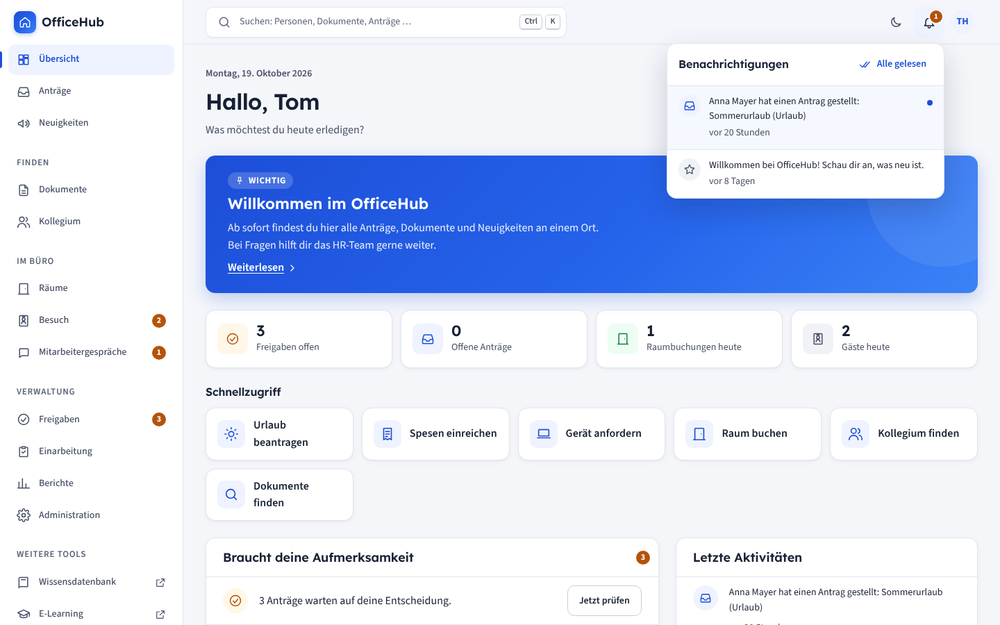
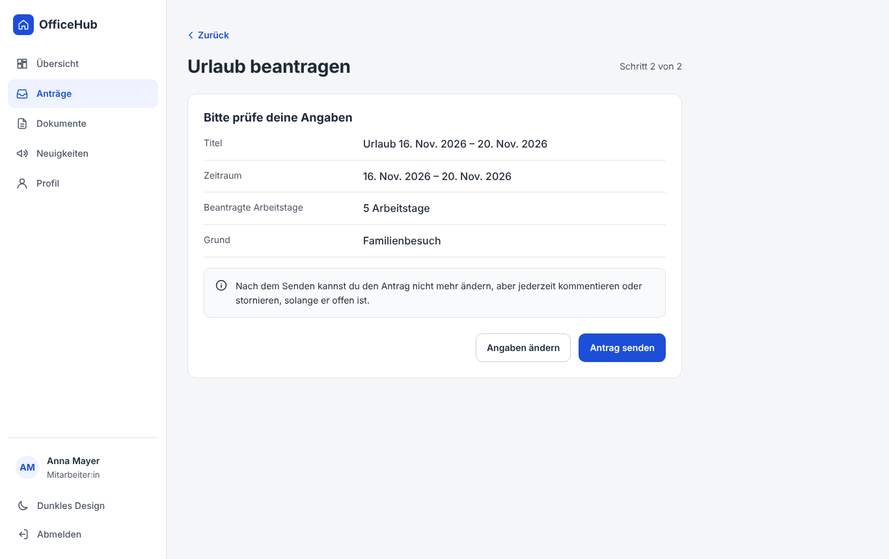
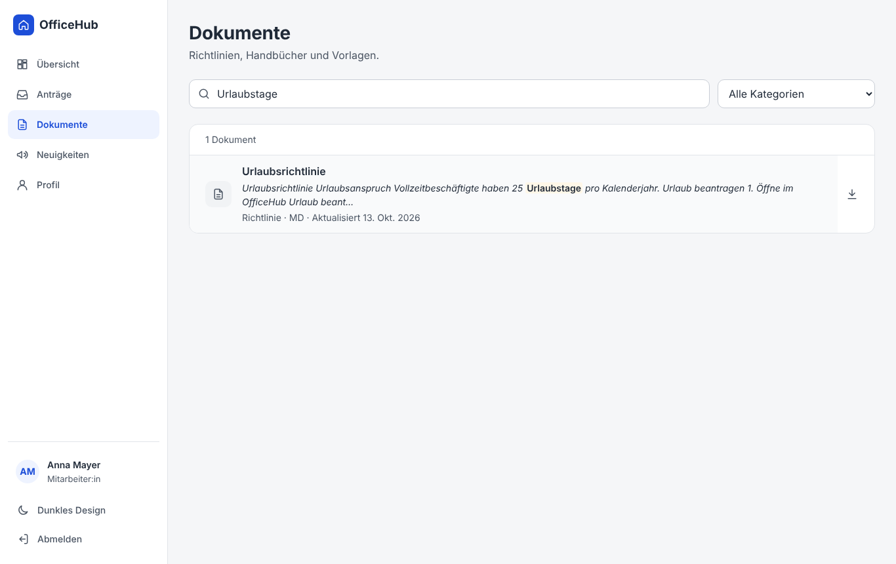
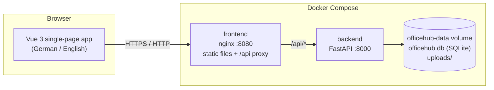

# OfficeHub

A clean, company-ready employee self-service portal for requests, documents, announcements, and simple office workflows.

OfficeHub is a small, self-hosted web app for small and medium-sized companies. Employees submit
vacation, expense and equipment requests through short guided forms, follow their status, read
company policies and see announcements. Managers and HR approve requests, publish news, manage
documents and export approved requests.

It is built to be **calm, simple and trustworthy** for people who do not work with technology all day:
no jargon, only the information needed for the current task, and the most common actions one click away.

> This project demonstrates what Claude Code can build in a short time. The application itself
> contains **no AI features** and needs **no internet connection or cloud service** to run.

## Screenshots

| Dashboard | Vacation request – review step |
| --- | --- |
|  |  |
| **Approvals** | **Document search** |
|  |  |
| **Mobile** | **Dark mode** |
|  |  |

_Screenshots show the fictional demo data. Replace them with your own after customising the portal._

## Features

**For every employee**

- Dashboard with a personal greeting, four quick actions, open requests, latest announcements and upcoming events
- Guided request forms with inline validation, a review step and a clear confirmation
  - Vacation (automatic working-day calculation) · Home office · Equipment · Expense (with receipt upload) · IT access · General request
- Request status at a glance: Draft, Submitted, In review, Approved, Rejected, Cancelled
- Comments and full history on every request; cancel while it is still pending
- Document library with full-text search (titles and content of PDF, Word, Markdown and text files) and category filter
- Announcements with pinned items, categories, publish and expiry dates
- Profile: name, department, job title, office location, preferred language (German / English)
- **People**: colleague directory with search and department filter, org chart, printable phone list with CSV export (everyone decides whether their numbers are shown)
- **Rooms**: book meeting rooms in quarter-hour slots, see the day's occupancy, cancel own bookings
- **Visitors**: register guests; reception checks them in and out
- **Appointment requests**: suggest up to three times to HR, IT or the manager; the approver confirms one
- **Employee reviews**: both sides prepare separately, then record and confirm the agreed goals
- **Onboarding**: checklist for new colleagues (HR, IT and manager tasks) with progress on the dashboard
- **More tools**: external links (knowledge base, e-learning, time tracking …) in the menu
- Contact person per section, configurable dashboard quick actions plus two personal favourites
- Version number and a plain-language "What's new" page
- Light and dark theme, works on desktop, tablet and phone

**For managers and HR / admins**

- Approvals inbox with filters by type, status, person and date
- Approve or reject with an optional comment (confirmation dialog)
- Simple figures: open requests, decisions this month, average handling time, approved vacation days
- Reports: absences per month, expenses per category, requests waiting too long, equipment handed out (each as CSV)
- Reception view for visitors, onboarding tasks of their own team
- CSV export of approved requests (opens correctly in Excel and LibreOffice)
- HR / admin only: publish, edit and archive announcements; upload, replace and archive documents; add people, set managers,
  change roles and reset passwords; start employee reviews; manage rooms, quick links, dashboard tiles and section contacts

## Architecture



| Part | Technology | Notes |
| --- | --- | --- |
| Frontend | Vue 3, Vite, TypeScript, vue-router | No UI library; design tokens in `frontend/src/styles.css` |
| Backend | Python 3.12, FastAPI, SQLAlchemy 2, Pydantic | All input validated with Pydantic models |
| Database | SQLite (WAL mode) | One file in the Docker volume |
| Files | Local filesystem | Uploaded documents and receipts in the Docker volume |
| Auth | Email + password, bcrypt, HttpOnly session cookie | Sessions stored server-side, configurable lifetime |

```
officehub/
├── backend/            FastAPI app, tests, Dockerfile
│   ├── app/routers/    auth, requests, announcements, documents, profile, admin
│   ├── app/services/   request rules (validation, permissions)
│   └── tests/          pytest suite
├── frontend/           Vue app, nginx config, Dockerfile
│   └── src/            views, components, locales (de/en), lib
├── docs/               user guide, UI guidelines, screenshots
├── docker-compose.yml
└── .env.example
```

## Quick start

Requirements: Docker with the Compose plugin.

```bash
git clone https://github.com/LetsManu/officehub.git
cd officehub
cp .env.example .env        # optional – the defaults start the demo
docker compose up -d        # uses the published images; add --build to build from source
```

- Portal: <http://localhost:8080>
- API (with interactive docs): <http://localhost:8000/docs>
- Health check: <http://localhost:8000/health>

With `DEMO_MODE=true` (the default) the sign-in page lists the fictional demo accounts.
All of them use the password `demo1234`.

| Person | Role | Email |
| --- | --- | --- |
| Anna Mayer | Employee (Marketing) | anna.mayer@example.com |
| Lukas Schmid | Employee (Sales) | lukas.schmid@example.com |
| Sara Novak | Employee (Finance) | sara.novak@example.com |
| Tom Huber | Manager (Operations) | tom.huber@example.com |
| Julia Weber | HR / Admin | julia.weber@example.com |

To reset the demo, remove the data volume: `docker compose down -v && docker compose up -d`.

### Deploying with Portainer

Every release publishes ready-built images (`ghcr.io/letsmanu/officehub-backend` / `-frontend`, amd64 + arm64)
and a Portainer stack file. See **[docs/deployment-portainer.md](docs/deployment-portainer.md)** and the
[latest release](https://github.com/LetsManu/officehub/releases/latest).

To publish a new release: `git tag v1.1.0 && git push origin v1.1.0` (or Actions → Release → Run workflow).

### Running in production mode

1. In `.env`, set `DEMO_MODE=false`, `ADMIN_EMAIL` and a strong `ADMIN_PASSWORD`.
2. Start with `docker compose up -d`. The first administrator is created on the first start
   (only when the database has no users yet).
3. Sign in, change the password under **Profile → Change password**, then add people under **Administration → People**.
4. Put OfficeHub behind your HTTPS reverse proxy and set `COOKIE_SECURE=true`.

### Local development

```bash
# Backend
cd backend
python -m venv .venv && . .venv/bin/activate
pip install -r requirements-dev.txt
DEMO_MODE=true uvicorn app.main:app --reload       # http://localhost:8000
python -m pytest -q

# Frontend (second terminal)
cd frontend
npm install
npm run dev                                        # http://localhost:5173, proxies /api to :8000
npm test && npm run build
```

## Environment variables

| Variable | Default | Description |
| --- | --- | --- |
| `DEMO_MODE` | `true` (compose) | Create fictional demo people, requests, announcements and documents on first start |
| `DEMO_LANGUAGE` | `de` | Language of the demo content (`de` or `en`) |
| `ADMIN_EMAIL` | – | First administrator, created when `DEMO_MODE=false` and no users exist |
| `ADMIN_PASSWORD` | – | Password for that administrator (change it after the first sign-in) |
| `SESSION_HOURS` | `12` | Hours until a sign-in expires |
| `COOKIE_SECURE` | `false` | Set to `true` when served over HTTPS |
| `MAX_UPLOAD_MB` | `15` | Largest allowed upload (nginx allows up to 25 MB) |
| `FRONTEND_PORT` | `8080` | Host port of the portal |
| `BACKEND_PORT` | `8000` | Host port of the API |
| `DATA_DIR` | `/data` | Folder for the database and uploads inside the container |

## User roles

| | Employee | Manager | HR / Admin |
| --- | :-: | :-: | :-: |
| Dashboard, own requests, documents, announcements, profile | ✓ | ✓ | ✓ |
| See all requests, approve / reject, comment on any request | | ✓ | ✓ |
| Statistics and CSV export | | ✓ | ✓ |
| Manage announcements and documents | | | ✓ |
| Reports, visitor reception, onboarding tasks of own team | | ✓ | ✓ |
| Add people, set managers, change roles, reset passwords | | | ✓ |
| Start employee reviews, manage rooms, links and portal settings | | | ✓ |

- Nobody can approve or reject their own request.
- Drafts are private: only the person who wrote them can see them.
- People can edit their own name, department, job title, office, phone numbers and language, but never their role or email.
- Employee reviews are visible only to the employee, the reviewer and HR. Each side sees the other's preparation only after both have finished.

## Security notes

- Passwords are hashed with bcrypt. Sessions are random tokens stored as SHA-256 hashes in the
  database and sent as `HttpOnly`, `SameSite=Lax` cookies (`Secure` with `COOKIE_SECURE=true`).
- Every state-changing API call requires the `X-Requested-With: OfficeHub` header, which browsers
  cannot send cross-site without CORS. Together with SameSite cookies this blocks CSRF. No CORS is enabled.
- Failed sign-ins are throttled (10 attempts per 15 minutes per address and email).
- All input is validated with Pydantic; all database access uses SQLAlchemy with bound parameters.
- Permission checks are enforced in the API for every endpoint. Requests that exist but are not
  visible to the caller return 404, so IDs cannot be probed.
- User content is rendered as text. Markdown documents are rendered by a small built-in renderer
  that escapes all HTML first and only allows `http(s)` and `mailto` links. Text and Markdown downloads are served as `text/plain`.
- Uploads are limited by size and extension, checked against the file signature, and stored under random names.
- CSV exports neutralise spreadsheet formulas (CSV injection).
- nginx sends a strict Content-Security-Policy (`default-src 'self'`), `X-Frame-Options: DENY` and `nosniff`.
- The backend container runs as an unprivileged user.
- No secrets are committed. Keep your `.env` file out of version control (it is in `.gitignore`).

For a real deployment: serve over HTTPS, use strong admin passwords, keep the host updated and make regular backups.

## Backup and restore

All data lives in the Docker volume `officehub_officehub-data` (`officehub.db` plus the `uploads/` folder).

```bash
# Backup (writes officehub-backup-YYYY-MM-DD.tar.gz to the current folder)
docker compose stop backend
docker run --rm -v officehub_officehub-data:/data -v "$PWD":/backup alpine \
  tar czf /backup/officehub-backup-$(date +%F).tar.gz -C /data .
docker compose start backend

# Restore
docker compose stop backend
docker run --rm -v officehub_officehub-data:/data -v "$PWD":/backup alpine \
  sh -c "rm -rf /data/* && tar xzf /backup/officehub-backup-YYYY-MM-DD.tar.gz -C /data"
docker compose start backend
```

Stopping the backend for a moment guarantees a consistent SQLite file. Schedule the backup command
(for example nightly with cron) and keep copies on another machine.

## Roadmap

- Email notifications when a request is decided (via the company's own SMTP server)
- Vacation balance per person and public holidays per location
- Team-based approvals (managers see only their team)
- Database migrations with Alembic (today new columns are added automatically on startup)
- Single sign-on (LDAP / Active Directory)
- More languages
- Calendar export (iCal) for approved vacation

## License

Choose a license before publishing this repository outside your organisation.
