# OfficeHub

**A self-hosted employee portal that feels like Microsoft Teams – for requests, chat, meetings, files and the
everyday paperwork of a small or medium-sized company. It runs on your own server and uses no cloud service.**

Employees request time off, chat in team spaces, meet by video, edit Word, Excel and PowerPoint files together, track their
time and find company documents – in one calm interface that works for people who do not work with technology all
day. Managers and HR approve requests, plan people and projects, publish news and manage the company's people and
equipment. Everything runs in one Docker Compose stack on your server: no outside services, no telemetry, no AI.

| | |
| --- | --- |
| **Everyday work** | Chat with threads and reactions, team spaces with files, tasks and wiki, calendar, video meetings and calls |
| **Paperwork** | Guided requests (vacation, expenses, equipment, IT access …), approvals, time tracking, planning, documents |
| **Your own infrastructure** | WordCraft / DeckCraft / GridCraft (ONLYOFFICE optional), Jitsi and a TURN relay in the same stack, set up by themselves |
| **Privacy** | End-to-end encrypted meetings (MLS + SFrame), device keys, company login with your own OpenID Connect server |
| **Everywhere** | Browser (installable app), Windows app with an Explorer folder like OneDrive, Android app |

> This project shows what Claude Code can build. The application itself contains **no AI features** and needs
> **no internet connection or cloud service** to run.

## Contents

- [Screenshots](#screenshots)
- [Features](#features)
- [Architecture](#architecture)
- [How it works](#how-it-works)
- [Quick start](#quick-start) · [Environment variables](#environment-variables) · [User roles](#user-roles)
- [Security notes](#security-notes) · [Backup and restore](#backup-and-restore)

## Screenshots

| Home page – the app bar on the left like Teams | Apps: everything else, pin what you need |
| --- | --- |
| 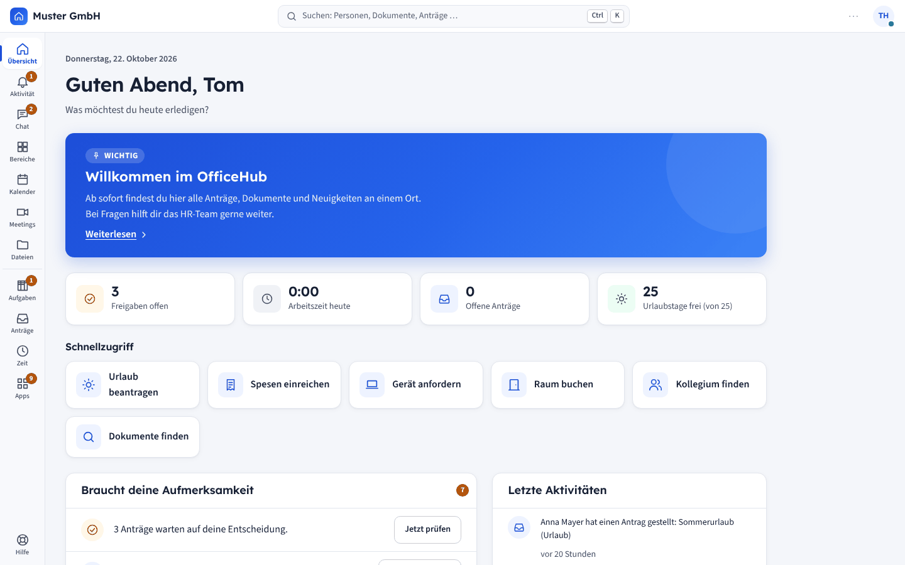 | 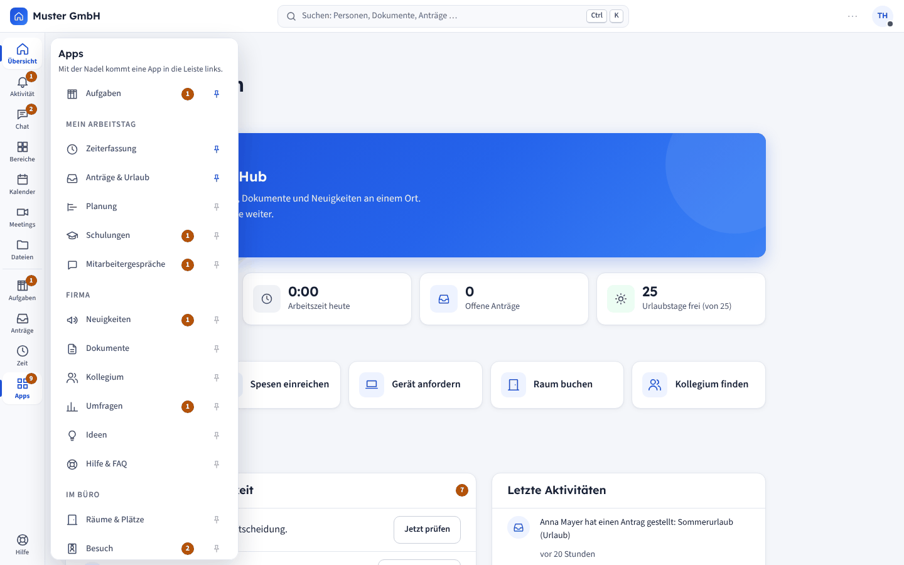 |
| **Chat in team spaces and direct messages** | **A team space: files, tasks, chat, wiki, meeting room** |
| 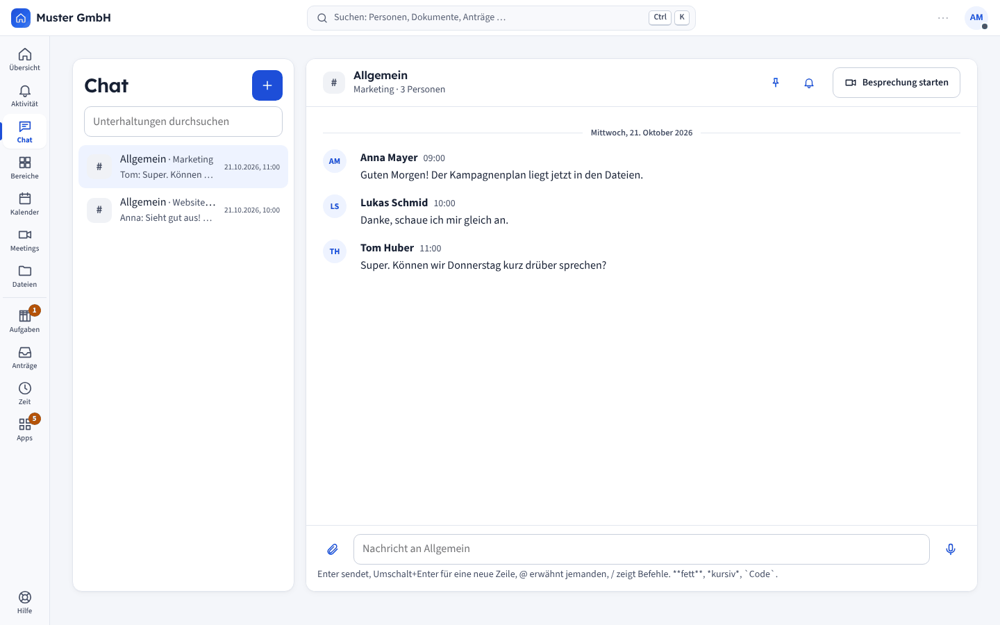 | 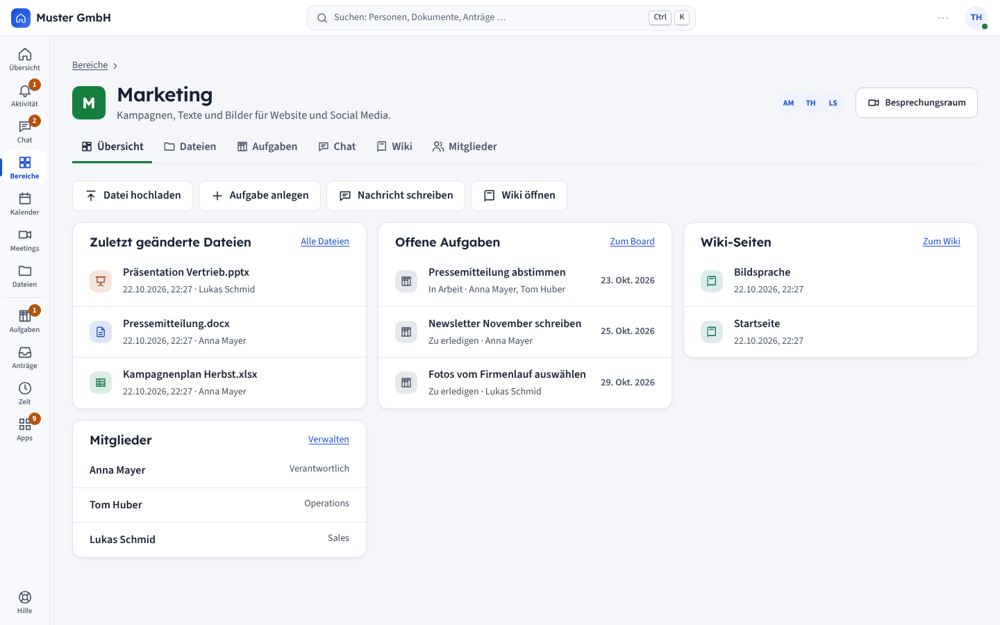 |
| **Calendar like Outlook** | **Planning: people × days with project bars** |
| 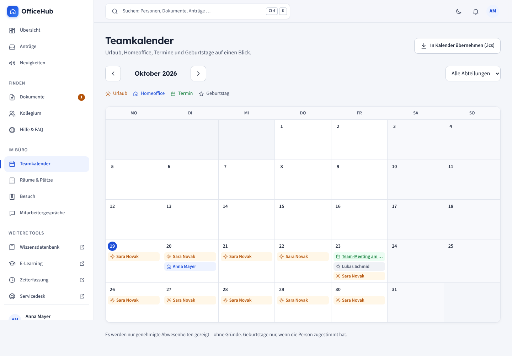 | 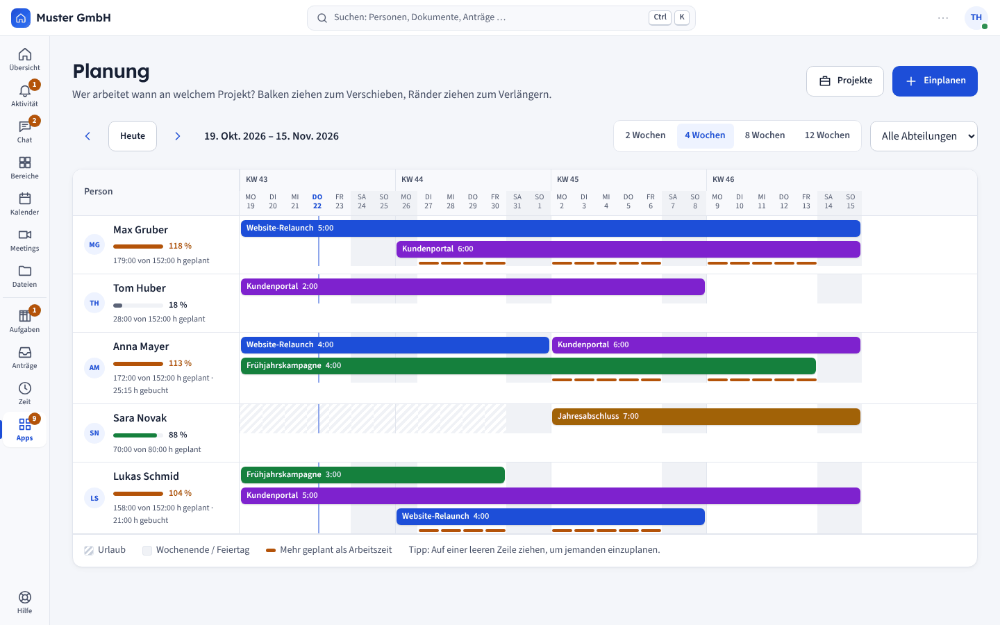 |
| **Time tracking** | **Files from all spaces** |
| 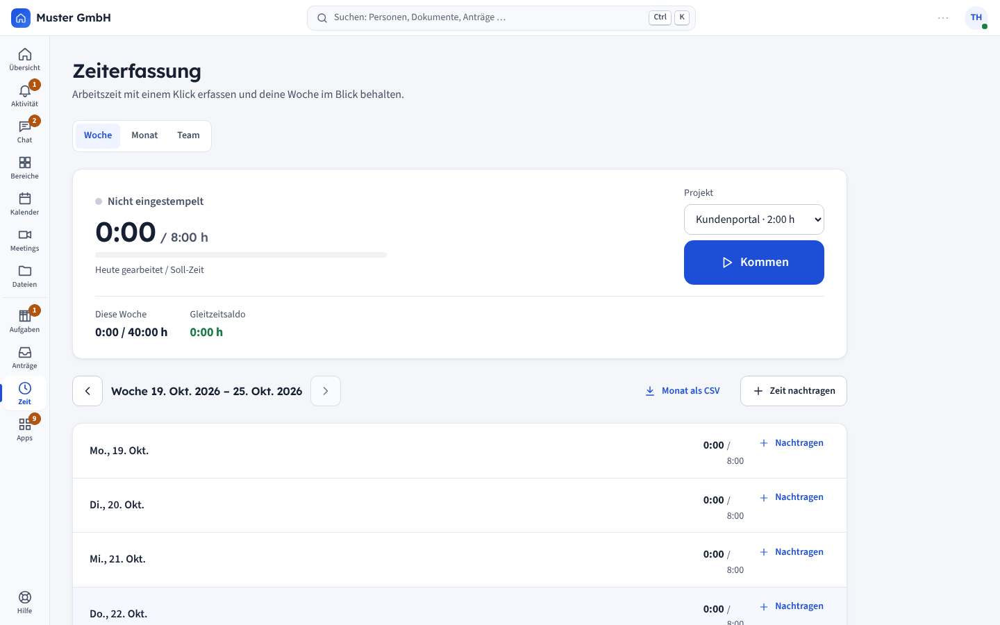 | 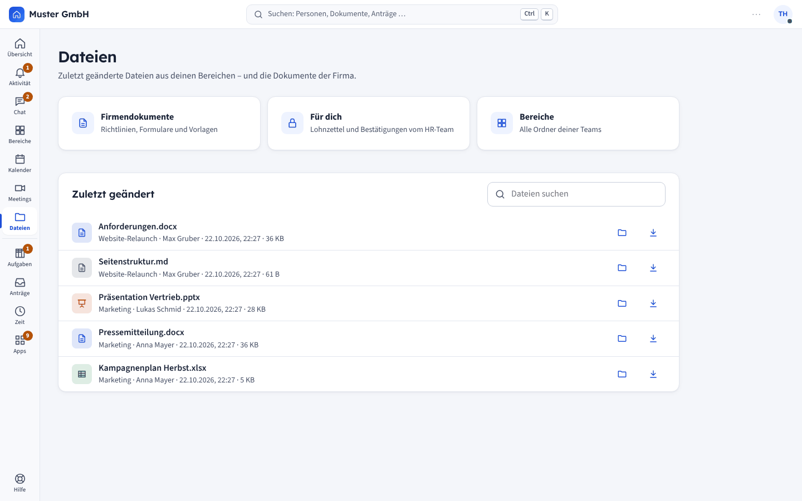 |
| **Approvals inbox** | **People directory with presence** |
| 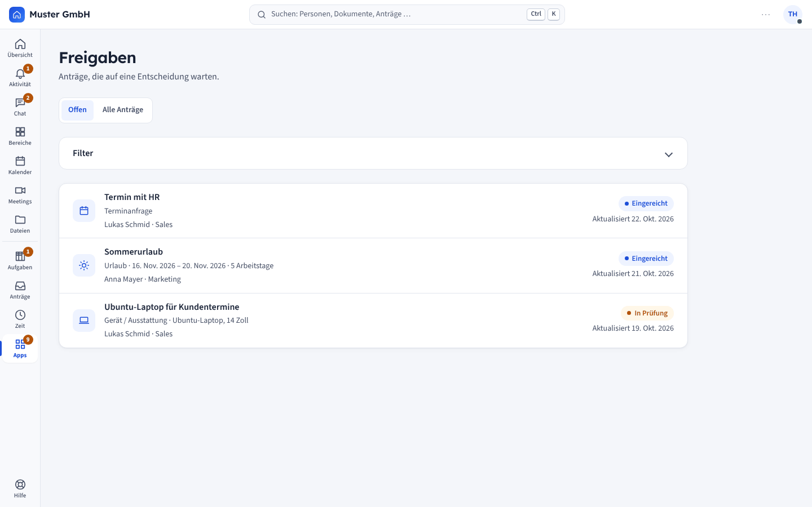 | 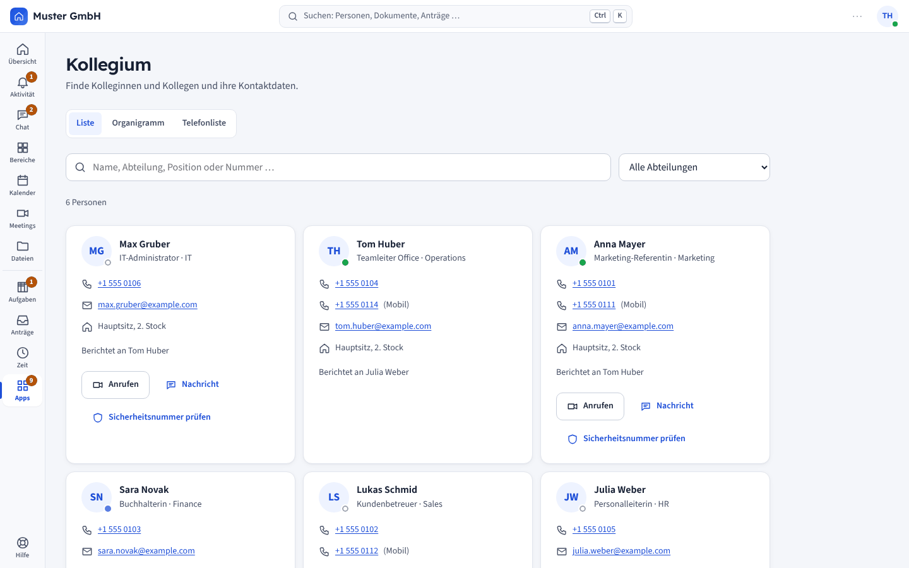 |
| **Search everything (Ctrl+K)** | **Meeting lobby with device test** |
| 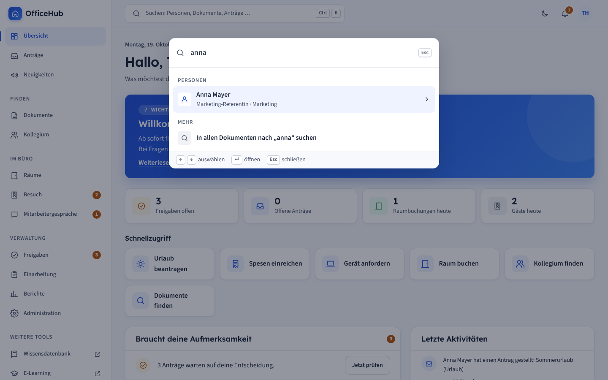 | 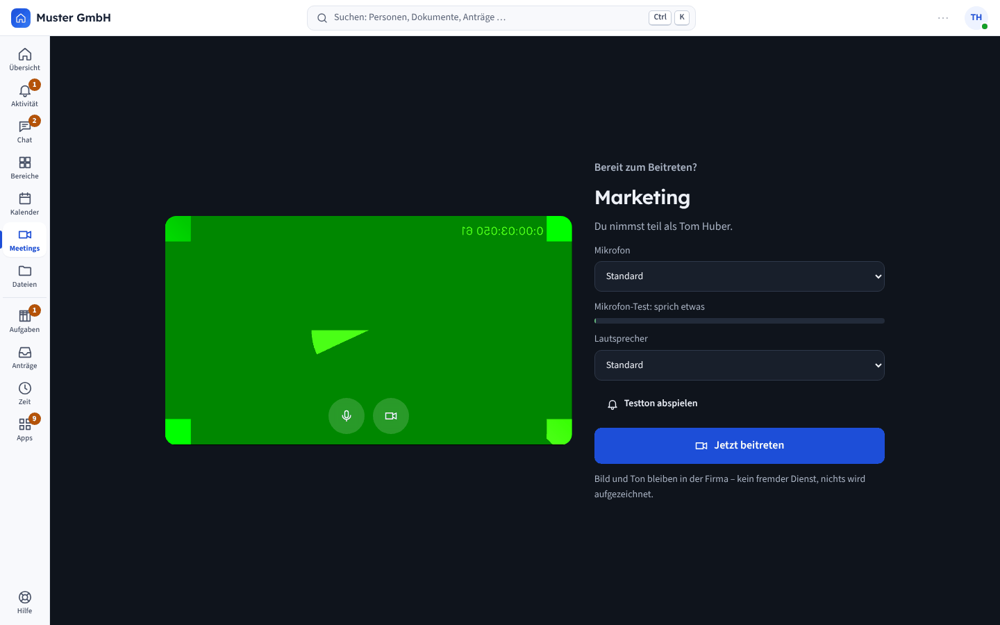 |
| **Excel files in GridCraft, edited together live** | |
| 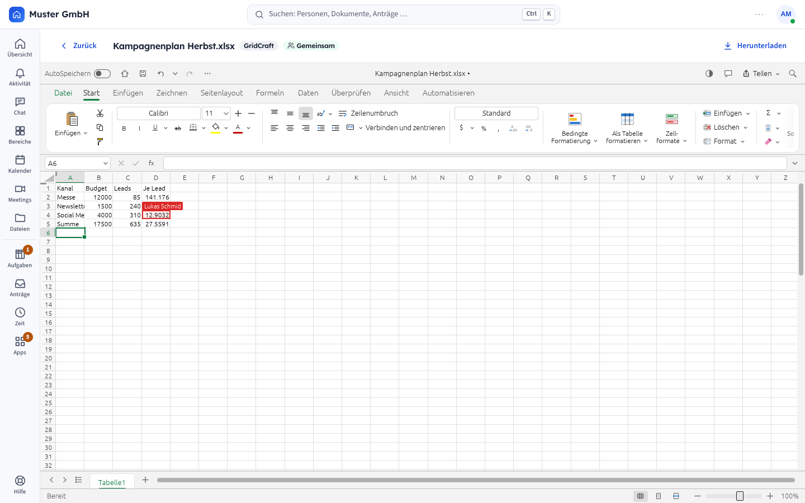 | |
| **Dark mode** | **Phone: tab bar at the bottom** |
| 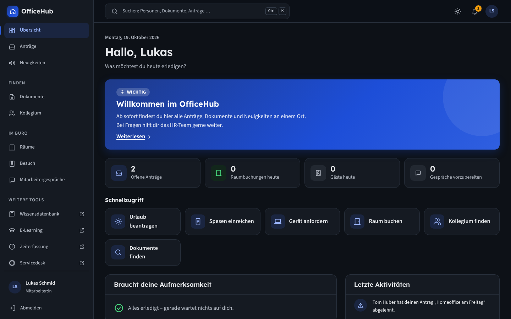 | 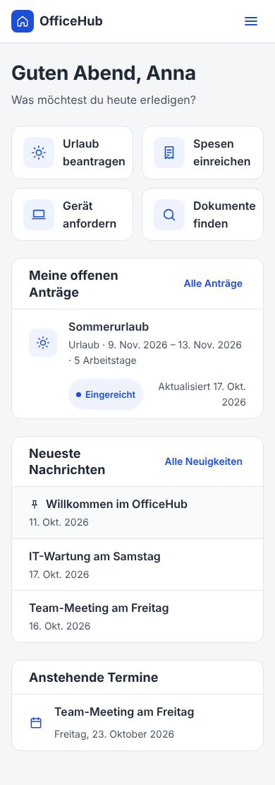 |

_Screenshots show the fictional demo data (German interface; English is built in too)._

## Features

**For every employee**

- Home page: pinned "Important" banner, numbers at a glance (working time today, open requests, vacation days left),
  "Needs your attention", recent activity, who is away, celebrations, company news and events
- One search for everything (**Ctrl+K**): pages, quick actions, people, documents, news, requests and tools
- Notification bell, optionally with e-mail copies through your own mail server
- **Time tracking**: clock in/out on a project, add or fix times for the last 31 days, weekly timesheet with targets,
  flexitime balance, break hints, CSV export; a month calendar with calendar weeks and hints per day, and handing in
  the month for the manager's approval
- **Team spaces** for teams and projects, each with:
  - **Files** with folders, versions, a 30-day trash and preview; Word, Excel and PowerPoint files are edited together
    in the browser with **WordCraft**, **DeckCraft** and **GridCraft** (open source, run in the same stack and switch
    themselves on; **ONLYOFFICE** optional)
  - a **task board** (Kanban) with assignees, due dates, labels and comments, plus "My tasks" across all spaces
  - **chat** channels with @mentions and file sharing, and direct messages between two people – with threads,
    reactions, pins, formatting, polls, voice messages, "/" commands and notification settings per conversation
  - a **wiki** with page history, "who is editing" and protection against overwriting each other's changes
  - a standing **meeting room** with a live "who is in it" count
- **Meetings and calls** with OfficeHub's own interface and nothing to set up: the company's own **Jitsi** server in
  the same stack carries every meeting and call, with a relay of its own for people on other networks; without Jitsi,
  browsers connect directly (calls and meetings up to 8 people). Plan meetings with invitations and calendar files (.ics), accept or decline, call a colleague from the
  people page or a chat (their portal rings), screen sharing, raise hand, reactions, meeting chat, shared notes that
  can be saved to a space's wiki, and guests from outside who wait until someone lets them in. Like Teams and Webex:
  gallery and speaker view, pin and spotlight, picture-in-picture, a shared whiteboard, recording in the browser,
  breakout rooms, town halls with a stage, mute everyone and remove people, device test, push to talk and the
  browser's noise suppression
- **End-to-end encrypted meetings** (per meeting, or required for chosen people): sound, video, screen, chat,
  reactions and whiteboard are locked in the browsers (MLS + SFrame), also through Jitsi; the server only passes on
  what it cannot read. **Who is who**: every browser has its own device key, new devices are confirmed from one you
  already use, people can be checked in person with a security number or QR code, and the meeting warns about (or,
  if the company wants, keeps out) anyone who is not confirmed
- **Files on the computer and open-source office programs**: spaces as a **network drive** (WebDAV, sign-in with app
  passwords) for Explorer, Finder and desktop programs; **check out / check in** like SharePoint; optional browser
  versions of **WordCraft** (documents), **GridCraft** (spreadsheets) and **DeckCraft** (presentations) that open a
  file and save it back as a new version; several people can edit the same document, workbook or presentation
  **together live** (in GridCraft cell by cell, with everyone's selected cells shown), and automatic saves go into one
  shared version; new spreadsheets can start from a template (budget, to-do list, weekly plan)
- **Planning**: people × days board with project bars (drag to plan, move and stretch), workload per person with
  vacation and public holidays taken out, projects with budgets and planned vs. booked hours
- Guided requests with inline validation and a review step: vacation (with remaining days and public holidays),
  home office, equipment, expenses with receipt, IT access, appointments and general requests; comments and history
- Documents with full-text search, plus a private **For you** tab for payslips and certificates from HR
- Announcements with must-read confirmation and small polls
- Layout like Teams: a bar across the top with search and your status, the **app bar** on the left (Start,
  Activity, Chat, Spaces, Calendar, Meetings, Files, pinned apps, **Apps** with everything else; a click goes back to
  where you were in that tool), a tab bar at the bottom on phones, an **Activity** feed and a **Files** page with recent files from all spaces
- **Presence** like Teams (available, busy, in a meeting, do not disturb, away, out of office – automatic from
  calendar, meetings, vacation and activity, or chosen with a status message), **desktop notifications** with sound,
  **meeting reminders**, **recurring meetings** and a **scheduling assistant** (free/busy, "next free time")
- **Calendar** like Outlook: day, work week, week and month with my meetings, room bookings, time off, holidays and
  events; click or drag into free time to plan a meeting; plus the **team calendar** with vacation, home office,
  public holidays, events and opt-in birthdays (iCal export)
- **People** directory, org chart and phone list with profile photos
- **Rooms, desks and parking** booking (meeting rooms by time, desks and parking by half or whole day)
- Visitors, employee reviews, onboarding checklists
- **Trainings**: mandatory trainings with due dates, repeats and certificates
- **Surveys** (anonymous, results from five answers) and an **ideas box** with votes and HR answers
- Help & FAQ, contact person per section, "What's new" page
- **Company login** (single sign-on) with your own OpenID Connect server such as Authentik or Keycloak, set up in
  Administration; signing in with a password always stays possible
- **System** page for administrators (Administration → System): is everything running? Version, office editing,
  meeting server and relay, free disk space, last backup and database size; the address meetings use with a
  browser test of the relay (best from a phone on mobile data) and hints when the stack file is outdated
- Profile with photo, two-factor sign-in (authenticator app + recovery codes), e-mail settings, deputy (managers)
  and the list of equipment you have
- German and English, light and dark theme, installable as an app, works on desktop, tablet and phone
- **Windows and Android apps** like Teams: their own window, notifications from Windows / Android, number on the
  icon, ringing calls even while the app is closed, start with the computer; they open your own portal (first start:
  enter the company address, then the usual sign-in or company login). Downloads under **Install the app**

**For managers and HR / admins**

- Approvals inbox; deputies can decide while a manager is away
- Team timesheets, reports and CSV exports
- Publish news (with read confirmations and reminders), manage documents and send personal documents
- People management, start date and vacation entitlement, onboarding and **offboarding** checklists
  (including the return of every item the person has)
- **Equipment register** with hand-out/return history
- **Branding**: company name, logo and accent colour (checked for readability)
- Public holidays built in for Austria, Germany (per state) and Switzerland, plus company days off
- Security: end-to-end encryption policy (warn about or keep out unconfirmed devices), require two-factor sign-in per role, reset it for a lost phone, **audit log** of important changes
- Surveys, trainings, help articles, rooms/desks/parking, quick links, dashboard tiles and section contacts

## Architecture

### The stack

Everything runs in one Docker Compose stack. In the Portainer stack only the portal (nginx) and the ports for audio and
video are published;
the office and meeting servers talk to OfficeHub inside the stack.

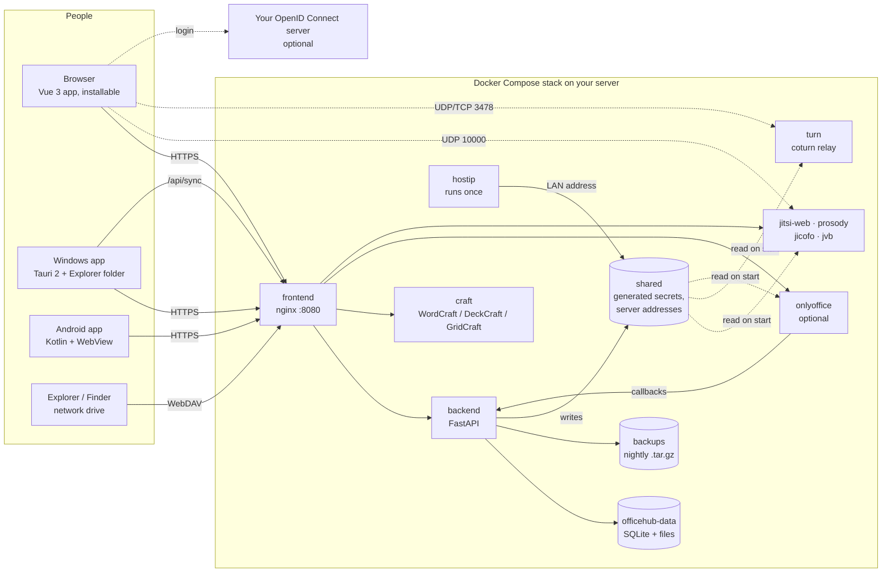

| Part | Technology | Notes |
| --- | --- | --- |
| Frontend | Vue 3, Vite, TypeScript, vue-router | No UI library; design tokens in `frontend/src/styles.css`; PWA with service worker |
| Backend | Python 3.12, FastAPI, SQLAlchemy 2, Pydantic | ~40 routers, one per area; all input validated with Pydantic models |
| Database | SQLite (WAL mode) | One file in the data volume; new columns are added on start |
| Files | Local filesystem | Space files and every version in the data volume; nightly backups |
| Sign-in | Password (bcrypt) + two-factor, OpenID Connect, app passwords | HttpOnly session cookies stored server-side; app passwords for WebDAV and sync |
| Live updates | Long polling and a 30-second heartbeat | No WebSocket server, no outside push service |
| Office editing | WordCraft / DeckCraft / GridCraft (Rust → WebAssembly, default), ONLYOFFICE (optional) | Detected by themselves (`services/probe.py`) |
| Meetings | Jitsi (lib-jitsi-meet) by default, built-in WebRTC without it, coturn relay | OfficeHub's own interface in both cases |
| End-to-end encryption | MLS (ts-mls) + SFrame in the browser, ECDSA device keys | The server only stores public keys and passes on encrypted messages |
| Apps | Tauri 2 (Rust) for Windows, Kotlin for Android | Load your portal; native notifications, calls, tray, Explorer folder |

### Repository layout

```
officehub/
├── backend/                FastAPI app, tests, Dockerfile
│   ├── app/main.py         app, middleware (CSRF header, security headers), startup
│   ├── app/deps.py         sign-in and role gates (Approver, Overseer, HR, Support, Staff, Admin)
│   ├── app/routers/        one module per area: requests, spaces, chat, meetings, rtc, keys, sso, webdav, sync …
│   ├── app/services/       rules: requests, people, meetings, rtc, mls, keys, collab, presence, sync, probe …
│   ├── app/db.py           engine, sessions, add_missing_columns()
│   ├── app/seed.py         first admin and the fictional demo company
│   └── tests/              pytest (200+ tests on the demo data)
├── frontend/               Vue app, nginx config, service worker, Dockerfile
│   └── src/
│       ├── views/          one view per page
│       ├── components/     AppLayout (app bar), MeetingRoom, VideoTile, ChatMessageItem, BaseModal …
│       ├── lib/            api, session, router helpers, rail, address, meeting, rtc, e2ee/, pwa, native …
│       └── locales/        de.ts (source of truth) and en.ts
├── craft/                  WordCraft / DeckCraft / GridCraft web build (from the LetsManu forks)
├── apps/windows/           Tauri 2 app, Explorer sync (Cloud Files API), sign-release.ps1
├── apps/android/           Kotlin app (WebView, bottom bar, feed service)
├── deploy/portainer/       stack file and stack.env attached to every release
├── docs/                   user guide, deployment guide, UI guidelines, screenshots
└── .github/workflows/      ci (tests, images), apps (Windows/Android builds), release
```

## How it works

### Requests, permissions and errors

Every API call goes through a router in `backend/app/routers/`. Who may do what is decided there, with the gates in
`deps.py` (`Approver`, `Overseer`, `HR`, `Support`, `Staff`, `Admin`) – never by comparing a role string. A person can
hold several roles (`User.roles`); admin includes everything. Things that exist but are not visible to the caller
answer **404**, so ids cannot be probed. Every error has the same shape, `{ detail, code, field? }`, and the frontend
translates `code` into a friendly sentence (`errors.*` / `validation.*` in the locales).

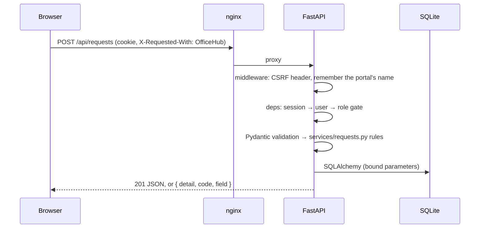

### Data without migration scripts

SQLite in WAL mode keeps everything in one file. On start, `db.add_missing_columns()` compares the models with the
database and adds new columns (each has a default or is nullable), so updating is just pulling a new image. A
SQLAlchemy `before_flush` hook (`services/sync.py`) gives every change to a space, folder or file the next number from
one counter – whichever way it happened (portal, WebDAV, office server, craft, sync) – which is what the desktop sync
reads. Backups are a nightly `.tar.gz` of the database and the files.

### Live updates without WebSockets

| What | How |
| --- | --- |
| Unread counts, presence, meeting reminders, "new version" | `GET /api/me/summary` every 30 seconds (heartbeat) |
| Meeting signalling (built in), breakout rooms, MLS messages | Long polling on `/api/rtc` |
| Live editing in WordCraft / DeckCraft / GridCraft | Yjs updates relayed per file by long polling (`/api/craft/collab/<file>`) |
| Android app notifications and ringing calls | One kept-open request, `GET /api/me/feed` (no Google push) |
| Windows Explorer folder | `GET /api/sync/changes?since=N&wait=25` |

Long polling works through every proxy and firewall that lets HTTPS through, and needs no extra server.

### Meetings and calls

OfficeHub has its own meeting interface (gallery, speaker view, chat, whiteboard, breakout rooms, town halls …)
on top of two engines. `services/probe.py` checks whether Jitsi is running; if it is, every new meeting and call
goes through it, otherwise browsers connect directly. A meeting that already started built in stays that way until
it is empty, so nobody ends up in another room.

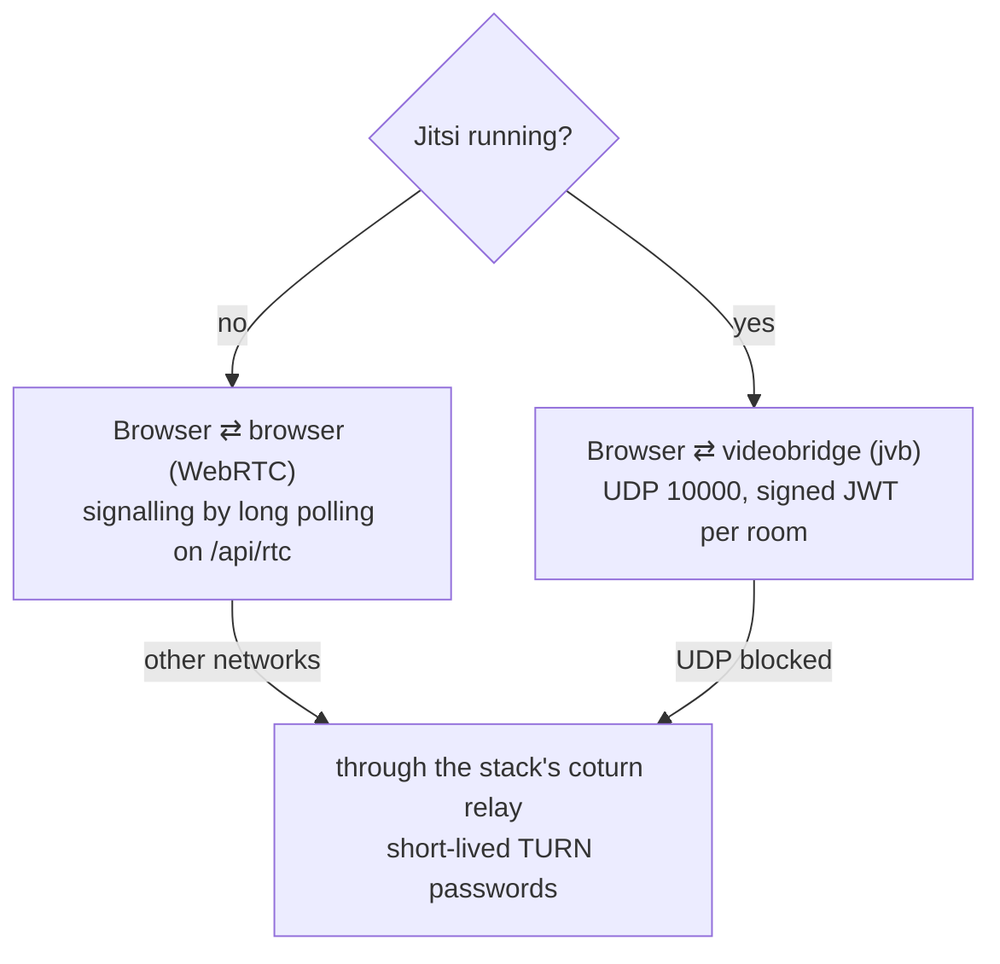

- **Tickets:** OfficeHub decides who may join and signs a ticket for exactly one room (a Jitsi JWT, or its own token
  for built-in meetings) that expires after six hours. Guests get one only after someone lets them in.
- **Addresses without setup:** the one-shot `hostip` container reads the server's office-network address from its
  routing table; the public address comes from `PUBLIC_IP`, `PORTAL_URL` or the name people open the portal with.
  When that name points at a proxy such as Cloudflare (which does not pass audio and video), the backend asks its
  own portal address who it is (`/api/address`, CF-Connecting-IP / X-Forwarded-For) and uses the office's real
  public address instead; the meeting servers wait for that check on start (`services/address.py`). The address is
  checked again every ten minutes; when it changes (a dynamic IP), the videobridge and the relay restart by
  themselves. Behind proxies the visitor's own address (not the proxy's) counts for the sign-in limits.
  Both go to `/shared`, where the videobridge and the relay read them – no outside STUN server is ever asked.
- **Relay passwords** follow coturn's `use-auth-secret` scheme: `username = expiry:user`,
  `password = base64(HMAC-SHA1(secret, username))`, valid for 12 hours, made from a secret generated on the first start.
- **Moderation, reactions and the whiteboard** travel as small "app" messages; breakout rooms work with either engine.

### End-to-end encrypted meetings

When a meeting is marked end-to-end encrypted (or a person is required to use it), the browsers form an
[MLS](https://www.rfc-editor.org/rfc/rfc9420) group (ts-mls). OfficeHub is only the delivery service: it stores key
packages, orders commits and passes on welcomes and ciphertext. Audio and video are encrypted per frame with SFrame
using insertable streams (also on the connections lib-jitsi-meet makes, VP8 only), so the videobridge forwards frames
it cannot read. Chat, reactions and whiteboard go as MLS messages; the server refuses them in plain text there.

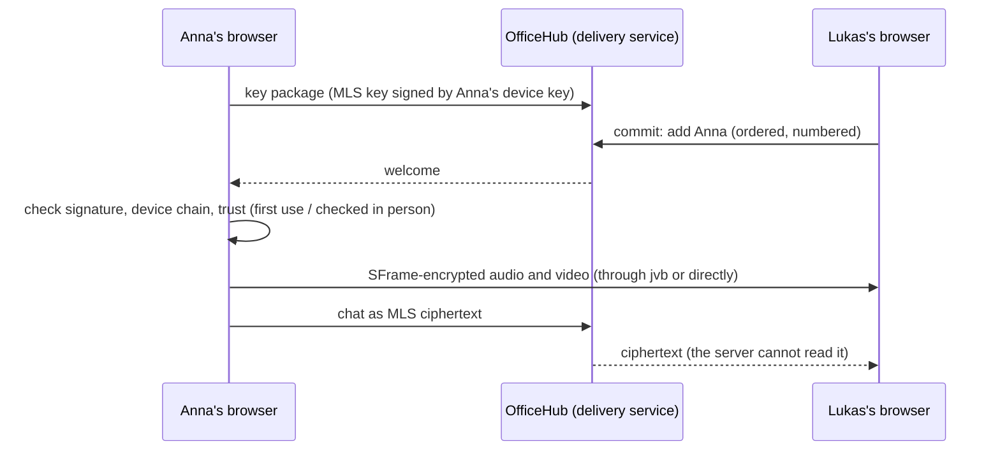

**Who is who:** every browser has its own non-extractable ECDSA device key (`e2ee/identity.ts`). A person's devices
sign each other; colleagues can confirm each other in person with a security number or QR code. OfficeHub never signs
anything – it only stores public keys – so a new or changed device shows up in the meeting (policy `warn` or `strict`).

### Office files: edited together, saved as versions

- **WordCraft, DeckCraft and GridCraft** (Rust, compiled to WebAssembly) open `?src=` and save to `?save=` with a
  short-lived file ticket. Several people edit together live: `services/collab.py` relays Yjs updates per file, and
  automatic saves go into one shared "together" version.
- **ONLYOFFICE** (optional) opens files over callbacks that only exist inside the stack (`/office-hooks/*` is not
  proxied by nginx). Every save is a new version.
- **Check-out** (`ensure_can_change`) applies to every way of saving: portal, WebDAV, ONLYOFFICE, craft and sync.

### Files on the computer

- **Network drive:** `/dav/` serves the spaces over WebDAV with app passwords (Basic auth), for Explorer, Finder and
  desktop programs.
- **OfficeHub folder in Explorer (Windows app):** like OneDrive's Files On-Demand, built on the Cloud Files API.
  Files show as placeholders with name, size and date and download when opened.

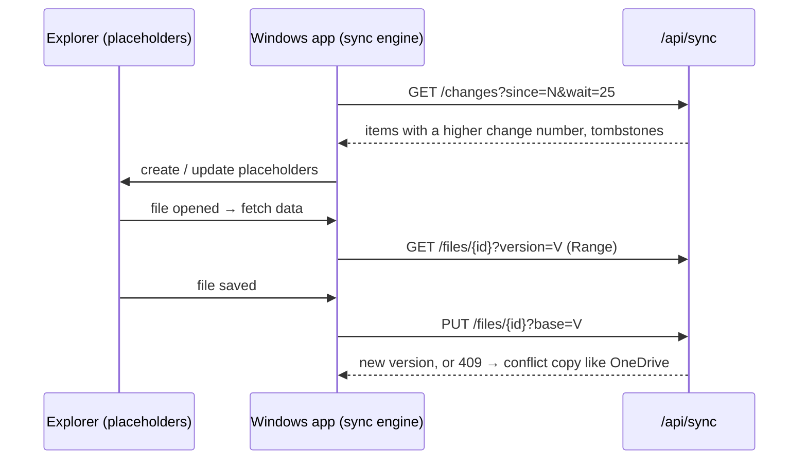

- **Sync status per computer:** one app password is one computer. Every `/api/sync` call counts as contact, and after
  each round the app sends `POST /api/sync/report` (computer name, whether the round went through, up to 20 files that
  did not upload with a short reason, changes still waiting; `services/sync_status.py`). People see their computers
  under Profile → Programs ("Last synced 5 minutes ago", "Problems: 3 files not uploaded – …"); service desk, HR and
  admins get the list of all computers under Administration (green: synced within 24 h without problems, amber:
  problems or longer ago, grey: never).

### Apps

The Windows (Tauri 2) and Android (Kotlin) apps load your own portal and add what a browser cannot: their own
window, tray and taskbar number, a jump list, notifications and ringing calls while closed, start with the computer,
the Explorer folder, a bottom bar and "Share → OfficeHub" on Android. The portal talks to them through
`frontend/src/lib/native.ts`; only the company's own address may (a Tauri runtime capability, an Android
WebMessageListener). App sign-ins last `APP_SESSION_DAYS`.

### Frontend

- **Layout like Teams:** a top bar with search and status, the app bar on the left (`lib/rail.ts`) that remembers
  where you were in each tool, a tab bar on phones. The address bar stays plain (`lib/address.ts`: in-memory history,
  back/forward and reload still work).
- **Plain language** in German and English (`locales/de.ts` is the source of truth; a test checks `en.ts` has the
  same keys).
- **Safe by default:** user content is shown with interpolation only; Markdown and chat are rendered by a small
  renderer that escapes HTML first. A strict Content-Security-Policy forbids inline styles and scripts.
- **Installable app (PWA):** the manifest comes from the backend (company name, colour, shortcuts, share target); the
  service worker keeps the shell and shared files; the icon shows unread counts.

### Optional servers and secrets

Nothing needs manual setup. `services/probe.py` checks whether the craft container, ONLYOFFICE or Jitsi
answer and switches features on and off by itself. Shared passwords (ONLYOFFICE JWT, Jitsi, the relay) are made
on the first start by `config._shared_secret` and kept in the `shared` volume, which the other containers mount
read-only.

### Tests and CI

- Backend: `python -m pytest -q` in `backend/` (200+ tests on the demo data, including permissions per role).
- Frontend: `npm test` (translations and logic) and `npm run build` (includes the type check).
- CI runs both and builds the images; the apps workflow builds the Windows installer and the Android APK and runs the
  Explorer sync end-to-end test on a Windows runner. Every release attaches the apps and the Portainer stack.

## Quick start

Requirements: Docker with the Compose plugin.

```bash
git clone https://github.com/LetsManu/officehub.git
cd officehub
cp .env.example .env        # optional – the defaults start the demo
docker compose up -d        # uses the published images; add --build to build from source
```

- Portal: <http://localhost:8080>
- API (with interactive docs): <http://localhost:8000/docs>
- Health check: <http://localhost:8000/health>

With `DEMO_MODE=true` (the default) the sign-in page lists the fictional demo accounts.
All of them use the password `demo1234`.

| Person | Role | Email |
| --- | --- | --- |
| Anna Mayer | Employee (Marketing) | anna.mayer@example.com |
| Lukas Schmid | Employee (Sales) | lukas.schmid@example.com |
| Sara Novak | Employee (Finance) | sara.novak@example.com |
| Tom Huber | Manager (Operations) | tom.huber@example.com |
| Julia Weber | Admin + HR | julia.weber@example.com |
| Max Gruber | Service desk (IT) | max.gruber@example.com |

To reset the demo, remove the data volume: `docker compose down -v && docker compose up -d`.

### Deploying with Portainer

Every release publishes ready-built images (`ghcr.io/letsmanu/officehub-backend` / `-frontend` / `-craft`, amd64 + arm64)
and a Portainer stack file. See **[docs/deployment-portainer.md](docs/deployment-portainer.md)** and the
[latest release](https://github.com/LetsManu/officehub/releases/latest).

**Updating from 3.8 or older:** Collabora is no longer part of the stack – Word, Excel and PowerPoint files open in
WordCraft, GridCraft and DeckCraft (the `craft` container). Take the new `docker-compose.yml` (or the Portainer stack
file of the release) and remove the old container with `docker compose up -d --remove-orphans` (Portainer: tick
**Prune services** when updating the stack). Nothing else changes: files, versions and settings stay.

To publish a new release: `git tag v1.1.0 && git push origin v1.1.0` (or Actions → Release → Run workflow). The
version must be new and higher than every earlier release, so `:latest` always is the newest code; add its "What's new"
entry to `frontend/src/lib/changelog.ts` first. To repair a broken release, run the workflow with **Rebuild** ticked:
it builds that version again from its own tag and leaves `:latest` alone when a newer version exists.

### Running in production mode

1. In `.env`, set `DEMO_MODE=false`, `ADMIN_EMAIL` and a strong `ADMIN_PASSWORD`.
2. Start with `docker compose up -d`. The first administrator is created on the first start
   (only when the database has no users yet).
3. Sign in, change the password under **Profile → Change password**, then add people under **Administration → People**.
4. Put OfficeHub behind your HTTPS reverse proxy and set `COOKIE_SECURE=true`.

### Local development

```bash
# Backend
cd backend
python -m venv .venv && . .venv/bin/activate
pip install -r requirements-dev.txt
DEMO_MODE=true uvicorn app.main:app --reload       # http://localhost:8000
python -m pytest -q

# Frontend (second terminal)
cd frontend
npm install
npm run dev                                        # http://localhost:5173, proxies /api to :8000
npm test && npm run build
```

## Environment variables

| Variable | Default | Description |
| --- | --- | --- |
| `DEMO_MODE` | `true` (compose) | Create fictional demo people, requests, announcements and documents on first start |
| `DEMO_LANGUAGE` | `de` | Language of the demo content (`de` or `en`) |
| `ADMIN_EMAIL` | – | First administrator, created when `DEMO_MODE=false` and no users exist |
| `ADMIN_PASSWORD` | – | Password for that administrator (change it after the first sign-in) |
| `SESSION_HOURS` | `12` | Hours until a sign-in expires |
| `COOKIE_SECURE` | `false` | Set to `true` when served over HTTPS |
| `MAX_UPLOAD_MB` | `15` | Largest allowed upload (nginx allows up to 25 MB) |
| `FRONTEND_PORT` | `8080` | Host port of the portal |
| `BACKEND_PORT` | `8000` | Host port of the API |
| `DATA_DIR` | `/data` | Folder for the database and uploads inside the container |
| `TIMEZONE` | `Europe/Vienna` | Local time zone for time tracking |
| `PORTAL_URL` | `http://localhost:8080` | Address of the portal, used for links in e-mails |
| `SMTP_HOST` | – | Mail server for optional e-mail notifications (empty = off) |
| `SMTP_PORT` | `587` | Mail server port |
| `SMTP_SECURITY` | `starttls` | `starttls`, `ssl` or `none` |
| `SMTP_USER` / `SMTP_PASSWORD` | – | Mail server login, if needed |
| `SMTP_FROM` | – | Sender address, e.g. `officehub@your-company.example` |
| `COMPOSE_PROFILES` | – | Extra parts: `onlyoffice` (second editor) |
| `PUBLIC_IP` | – | Public IP of the server for meetings with people outside the office (empty: what `PORTAL_URL` resolves to) |
| `ICE_SERVERS` | – | Replaces the stack's relay with STUN/TURN server(s) of your own, comma-separated (`ICE_USERNAME`, `ICE_PASSWORD`) |

Passwords between OfficeHub and the office/meeting servers (`ONLYOFFICE_JWT_SECRET`, `JITSI_APP_SECRET`,
`JITSI_INTERNAL_PASSWORD`) are made automatically on the first start and kept in the `shared` volume. Set them only if
you want your own.

## User roles

Everyone is an employee; a person can hold several more roles at once (Administration → People → Change roles).

| | Employee | Team lead | Manager | HR | Service desk | Admin |
| --- | :-: | :-: | :-: | :-: | :-: | :-: |
| Dashboard, own requests, documents, announcements, profile | ✓ | ✓ | ✓ | ✓ | ✓ | ✓ |
| Decide requests and time sheets of their own team, plan their team | | ✓ | ✓ | ✓ | | ✓ |
| Decide everyone's requests, statistics, reports and CSV export | | | ✓ | ✓ | | ✓ |
| Decide IT access and equipment requests, equipment register | | | | ✓ | ✓ | ✓ |
| Reset passwords and two-factor sign-in (not of administrators) | | | | ✓ | ✓ | ✓ |
| People, roles (except administrator), personal documents, onboarding / offboarding | | | | ✓ | | ✓ |
| News, documents, reviews, trainings, surveys, ideas, help, links, public holidays | | | | ✓ | | ✓ |
| Company login, security, backups, branding, office, rooms, portal settings, audit log | | | | | | ✓ |

- Only an administrator gives or takes away the administrator role or changes an administrator's account.
- With company login, roles can follow groups of your login server (one group per role, optional).
- Accounts with the former "HR / Admin" role are administrators and HR after the update.

- Nobody can approve or reject their own request.
- Drafts are private: only the person who wrote them can see them.
- People can edit their own name, department, job title, office, phone numbers and language, but never their role or email.
- Employee reviews are visible only to the employee, the reviewer and HR. Each side sees the other's preparation only after both have finished.

## Security notes

- Passwords are hashed with bcrypt. Sessions are random tokens stored as SHA-256 hashes in the
  database and sent as `HttpOnly`, `SameSite=Lax` cookies (`Secure` with `COOKIE_SECURE=true`).
- Every state-changing API call requires the `X-Requested-With: OfficeHub` header, which browsers
  cannot send cross-site without CORS. Together with SameSite cookies this blocks CSRF. No CORS is enabled.
- Failed sign-ins are throttled (10 attempts per 15 minutes per address and email).
- All input is validated with Pydantic; all database access uses SQLAlchemy with bound parameters.
- Permission checks are enforced in the API for every endpoint. Requests that exist but are not
  visible to the caller return 404, so IDs cannot be probed.
- User content is rendered as text. Markdown documents are rendered by a small built-in renderer
  that escapes all HTML first and only allows `http(s)` and `mailto` links. Text and Markdown downloads are served as `text/plain`.
- Uploads are limited by size and extension, checked against the file signature, and stored under random names.
- CSV exports neutralise spreadsheet formulas (CSV injection).
- Meetings: OfficeHub decides who may join and hands out a signed ticket for exactly one meeting that expires after
  six hours (built in and Jitsi alike). Guests get one only after someone in the meeting let them in. No outside
  STUN/TURN server is used; the stack's own relay runs on an isolated network and hands out 12-hour passwords. Audio and
  video are always encrypted in transit (WebRTC). Nothing is recorded on the server.
- End-to-end encrypted meetings: keys are made and kept only in the browsers (device keys cannot be exported).
  OfficeHub only delivers MLS messages and refuses chat, reactions and whiteboard in plain text there; it never signs
  keys, so a changed or unconfirmed device shows up in the meeting.
- Company login (OpenID Connect) uses the authorization code flow with PKCE, state and nonce against your own server.
- nginx sends a strict Content-Security-Policy (`default-src 'self'`), `X-Frame-Options: DENY` and `nosniff`.
- The backend container runs as an unprivileged user.
- No secrets are committed. Keep your `.env` file out of version control (it is in `.gitignore`).

For a real deployment: serve over HTTPS, use strong admin passwords, keep the host updated and make regular backups.

## Backup and restore

OfficeHub makes a backup every night: database and files in one `.tar.gz` in the backup folder (`BACKUP_DIR`,
in the stack a volume of its own, or a NAS share via `BACKUP_PATH`). The newest 14 are kept. **Administration →
Backups** shows the last result and can back up now, download and restore (the current state is backed up first).
The archive holds `officehub.db`, `uploads/` and `manifest.json`, so it can also be unpacked by hand into the data
volume while the backend is stopped.

**Second copy on the NAS.** So that one dead disk cannot take everything, OfficeHub can copy every new backup
(nightly and "Back up now") to the company's own NAS – still no cloud. In **Administration → Backups → Second copy on
the NAS** choose a **Windows share** (Synology, QNAP, Windows server: `\\nas\backup\officehub` or
`smb://nas/backup/officehub`, user and password) or **SFTP** (host, port, user, password, folder). **Test
connection** writes and deletes a small file and says in plain words what is wrong (wrong password, share not found,
NAS not reachable, no write permission, NAS full). Missing subfolders are created. The panel shows the last copy in
green or red; a failed copy never touches the local backup. The newest copies are kept on the NAS (by default as many
as locally, or a number of its own); only files named like OfficeHub backups are ever deleted there. Copies are
uploaded as a hidden `.part` file and renamed when complete. The password is stored in the settings like the company
login's client secret and never sent back to the browser. For SFTP the NAS's host key is remembered on the first
connection; if it changes, copying stops until the settings are saved again. Libraries: `smbprotocol` (SMB 2/3) and
`paramiko` (SFTP), both pure Python. Note: restoring an archive also brings back the NAS settings of that time.

## Roadmap

- Database migrations with Alembic (today new columns are added automatically on startup)
- LDAP / Active Directory sign-in (OpenID Connect already works)
- More languages
- Public holidays per location (today one region for the whole company)

## License

Choose a license before publishing this repository outside your organisation.
